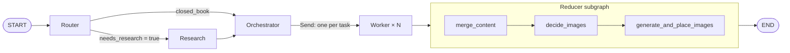
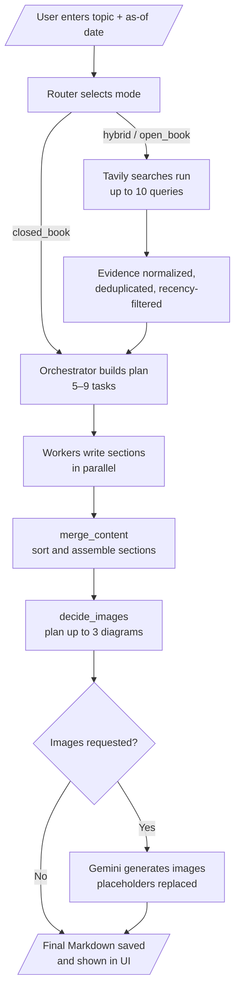

# Research-Grounded Blog Agent

A multi-agent system built with **LangGraph** that turns a topic into a fully researched, cited, and illustrated technical blog post. A router decides whether live web research is needed, an orchestrator plans the article, parallel workers write each section, and a reducer assembles the final Markdown with generated diagrams. A Streamlit interface exposes every stage of the pipeline.

**Live app:** https://research-grounded-blog-agent.streamlit.app/

> API keys are currently disabled on the hosted app, so blog generation runs locally (see [Getting Started](#getting-started)).

---

## Demo

https://github.com/user-attachments/assets/85106a60-482a-41a5-a0f6-7497f03399d8

## Highlights

- **Multi-agent LangGraph pipeline** with conditional routing, a dynamic fan-out of parallel writer agents, and a nested reducer subgraph.
- **Adaptive research:** the router classifies each topic as `closed_book`, `hybrid`, or `open_book` and sets a recency window (3650, 45, or 7 days) that controls how fresh the evidence must be.
- **Grounded writing:** workers may only cite URLs from the collected evidence, and news-style posts are blocked from inventing events.
- **Structured outputs everywhere:** every agent returns a Pydantic schema (`RouterDecision`, `EvidencePack`, `Plan`, `GlobalImagePlan`), so the graph passes typed state rather than free text.
- **Automatic illustrations:** an image-planning agent proposes up to three technical diagrams, which are generated with Gemini and placed inline.
- **Graceful degradation:** missing search results or failed image generation do not break the run. Failed images become labeled placeholder blocks.
- **Interactive UI:** a Streamlit app with live node-by-node progress, tabs for plan, evidence, preview, images, and logs, a history of past posts, and Markdown and ZIP export.

---

## Architecture



The main graph is built in `bwa_backend.py`. The reducer is a separate compiled `StateGraph` embedded as a single node.

---

## Workflow



---

## Agents and Their Functions

| Agent | Type | Responsibility |
|---|---|---|
| **Router** | LLM, structured output (`RouterDecision`) | Decides whether web research is needed before planning. Chooses the mode (`closed_book`, `hybrid`, `open_book`), sets the recency window, and proposes 3–10 scoped search queries. |
| **Research** | Tavily search + LLM extraction (`EvidencePack`) | Runs up to 10 queries (6 results each), normalizes the raw results into `EvidenceItem`s with URL, date, and snippet, deduplicates by URL, and for `open_book` drops anything older than the cutoff. |
| **Orchestrator** | LLM, structured output (`Plan`) | Produces the article plan: title, audience, tone, blog kind (`explainer`, `tutorial`, `news_roundup`, `comparison`, `system_design`), and 5–9 tasks, each with a goal, 3–6 bullets, and a word target. Forces `news_roundup` for `open_book` topics. |
| **Worker** (× N) | LLM, run in parallel | Each worker writes one section of the post. Workers receive only their own task plus the evidence, cover every bullet in order, stay within ±15% of the word target, and cite only supplied URLs. A scope guard keeps news posts away from tutorial content. |
| **merge_content** | Deterministic node | Sorts the completed sections by task ID and assembles them under the blog title. |
| **decide_images** | LLM, structured output (`GlobalImagePlan`) | Reviews the merged article, inserts up to three `[[IMAGE_n]]` placeholders where a diagram materially helps, and writes a generation prompt, size, and quality for each. Returns the article unchanged if no images are needed. |
| **generate_and_place_images** | Gemini image model | Generates each image into `images/`, skips files that already exist, replaces placeholders with Markdown image tags and captions, falls back to a labeled error block on failure, and writes the final `<blog-title>.md` file. |

### Research modes

| Mode | Research | Recency window | Use case |
|---|---|---|---|
| `closed_book` | No | 3650 days | Evergreen concepts answered from model knowledge |
| `hybrid` | Yes | 45 days | Concepts plus current tools, models, or examples, with citations |
| `open_book` | Yes | 7 days | Weekly roundups and news; claims must trace to a source |

---

## Tech Stack

- **Orchestration:** LangGraph (`StateGraph`, conditional edges, `Send` fan-out, subgraphs)
- **LLM framework:** LangChain (`langchain-openai`, `langchain-core`, `langchain-community`)
- **Reasoning model:** OpenAI `gpt-5.6-luna`, configured in `bwa_backend.py`
- **Web search:** Tavily (`TavilySearchResults`)
- **Image generation:** Google Gemini (`gemini-3.1-flash-lite-image`) via `google-genai`
- **Schemas and validation:** Pydantic v2
- **Frontend:** Streamlit, with pandas for tables
- **Secrets:** Streamlit secrets management

---

## Project Structure

```
.
├── bwa_backend.py          # LangGraph agents, state, routing, reducer, and image generation
├── bwa_frontend.py         # Streamlit UI: generation, progress, tabs, history, downloads
├── requirements.txt
├── 1_bwa_basic.ipynb                 # Baseline blog-writing workflow
├── 2_bwa_improved_prompting.ipynb    # Prompt refinements
├── 3_bwa_research.ipynb              # Research-grounded version
├── 4_bwa_research_fine_tuned.ipynb   # Research tuning
├── 5_bwa_image.ipynb                 # Image generation
├── tavily_test.ipynb                 # Search-tool experiments
├── attention_is_all_you_need_..._bundle/   # Sample generated post with its images
└── .devcontainer/          # One-click Codespaces / VS Code dev environment
```

The notebooks document the iterative build-up of the system, from a baseline workflow to research and image generation. The final, consolidated version lives in `bwa_backend.py`.

---

## Sample Output

The sample post [*Attention Is All You Need: How Transformers Replaced Recurrence with Attention*](https://github.com/1adityakadam/Research-Grounded-Blog-Agent-using-LangGraph-Tavily-Gemini/blob/main/attention_is_all_you_need_how_transformers_replaced_recurrence_with_attention.md) was generated by the pipeline. It contains multiple sections, technical diagrams in `images/`, and a structure that follows the orchestrator's plan.

---

## Getting Started

### Prerequisites

- Python 3.11+
- An OpenAI API key (required)
- A Tavily API key (enables web research)
- A Google API key (enables image generation)

### Installation

```bash
python -m venv .venv
source .venv/bin/activate        # Windows: .venv\Scripts\activate
pip install -r requirements.txt
```

### Configuration

API keys are stored in Streamlit secrets. For local runs, create `.streamlit/secrets.toml` in the project root (this file is git-ignored):

```toml
OPENAI_API_KEY = "your_openai_key"
TAVILY_API_KEY = "your_tavily_key"
GOOGLE_API_KEY = "your_google_key"
```

On Streamlit Community Cloud, add the same keys under **App settings → Secrets**.

Without `TAVILY_API_KEY`, research returns no results and the pipeline continues in closed-book style. Without `GOOGLE_API_KEY`, the post is still written, and each image slot shows a labeled failure block.

### Run the App

```bash
streamlit run bwa_frontend.py
```

Open the URL Streamlit prints (default `http://localhost:8501`), enter a topic, choose an as-of date, and click **Generate Blog**.

The app writes the output Markdown file and any images to the project folder, where they appear under **Past blogs** and can be exported as Markdown, an images ZIP, or a full bundle ZIP.

---

## How a Run Works

1. **Route:** the router reads the topic and as-of date and selects a mode.
2. **Research (if needed):** queries run through Tavily, results are normalized and deduplicated, and stale items are filtered for `open_book`.
3. **Plan:** the orchestrator turns the topic and evidence into a structured outline.
4. **Write in parallel:** one worker per task writes its section at the same time.
5. **Assemble:** sections are merged in order, the image planner inserts placeholders, and Gemini generates the images.
6. **Save:** the final Markdown is written to disk and rendered in the UI.

The Streamlit app streams each node as it finishes, so the progress panel and logs update live.
